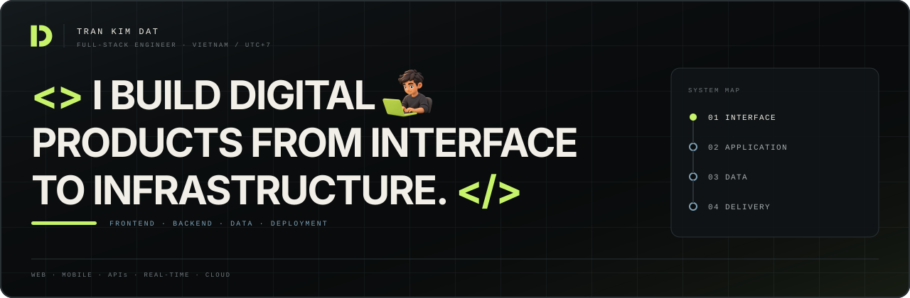
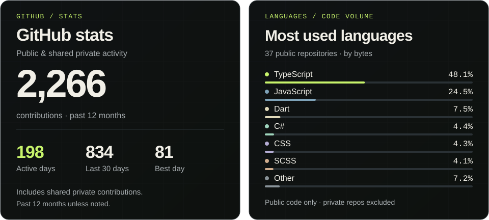
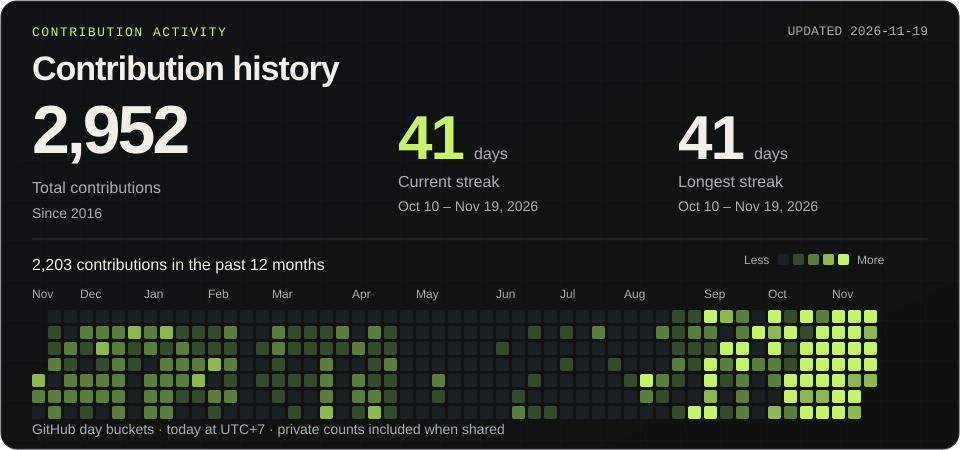

  <picture>
    <source media="(max-width: 479px), (min-width: 768px) and (max-width: 879px)" srcset="./assets/profile-masthead-mobile.svg" />
    <source media="(max-width: 1100px)" srcset="./assets/profile-masthead-wide.svg" />
    
  </picture>

I'm a full-stack engineer with nearly 3 years of experience building web and cross-platform mobile applications. My work spans frontend interfaces, backend APIs, authentication, data models, AI integrations, and deployment.

## Building now

### Bravodemy | [main.bd-internal.dev](https://main.bd-internal.dev)

An AI learning platform that turns a learning goal into a researched syllabus, short lessons, practice, and progress tracking. Currently in development.

`goal` → `grounded research` → `learning path` → `practice` → `review`

I built the bilingual Next.js frontend and backend foundations with FastAPI, SQLAlchemy, and PostgreSQL. My work includes authentication, Polar billing, Exa/Gemini/Tavily research integrations, Redis, automated checks, and Docker deployments on Render and Neon. Another developer is responsible for core lesson generation.

### HuntingAlice | [main.ha-internal.dev](https://main.ha-internal.dev)

A B2B prospecting platform for company research, competitor analysis, campaign planning, and lead discovery. Research results include source evidence and relevant decision-makers for sales teams to review.

I build frontend and backend workflows with Next.js, NestJS/Fastify, PostgreSQL, Drizzle, and Inngest. Shared contracts and WebSocket updates connect the research interfaces to background workflows and saved campaign data.

### OathFront | [oathfront.vercel.app](https://oathfront.vercel.app)

A tactical PvE card game with hero abilities, deck building, tutorials, and deterministic bots. Players combine hero powers and card effects in turn-based battles.

I built the TypeScript game rules and bot engine, Next.js client, and server-authoritative Fastify API with PostgreSQL persistence. The interface supports direct card interaction, keyboard controls, and reduced motion.

## Selected systems

### TapMood

A real-time social check-in product built across Flutter and ASP.NET Core. The system includes SignalR, Firebase notifications, Gemini-assisted features, and resumable media uploads with background video processing.

### HabiStride | [habi-stride-ui.onrender.com](https://habi-stride-ui.onrender.com)

A gamified habit tracker built with Next.js and NestJS, including Google OAuth, HttpOnly authentication, streak logic, leaderboards, and daily timezone-aware snapshots.

### Portfolio | [dattk.dev](https://dattk.dev)

A bilingual Next.js portfolio with project case studies, a project explorer, GitHub activity, a contact form, and a publishing system backed by Neon PostgreSQL.

## Tech stack

Languages, frameworks, and services used across my web, mobile, and AI projects.

  <picture>
    <source media="(max-width: 479px), (min-width: 768px) and (max-width: 879px)" srcset="./assets/how-i-ship-mobile.svg" />
    <source media="(max-width: 1100px)" srcset="./assets/how-i-ship-wide.svg" />
    <source media="(max-width: 1439px)" srcset="./assets/how-i-ship-tablet.svg" />
    
  </picture>

**Gemini Grounded Search:** grounding with Google Search through the Gemini API, using an API key created in [Google AI Studio](https://aistudio.google.com/apikey).

## GitHub activity

  <a href="https://github.com/dattk2002?tab=overview">
    <picture>
      <source media="(max-width: 479px), (min-width: 768px) and (max-width: 879px)" srcset="./assets/github-stats-mobile.svg" />
      <source media="(max-width: 1100px)" srcset="./assets/github-stats-wide.svg" />
      <source media="(max-width: 1439px)" srcset="./assets/github-stats-tablet.svg" />
      
    </picture>
  </a>

  <a href="https://github.com/dattk2002?tab=overview">
    <picture>
      <source media="(max-width: 479px), (min-width: 768px) and (max-width: 879px)" srcset="./assets/github-activity-mobile.svg" />
      <source media="(max-width: 1100px)" srcset="./assets/github-activity-wide.svg" />
      <source media="(max-width: 1439px)" srcset="./assets/github-activity-tablet.svg" />
      
    </picture>
  </a>

<!-- PROFILE-STATS:START -->

Activity in numbers · updated 2026-11-20

| Metric | Value | Scope |
| --- | ---: | --- |
| All-time contributions | 2,965 | Since 2016-07-25 |
| Contributions | 2,205 | 2025-11-21 to 2026-11-20 |
| Current streak | 42 days | Oct 10 – Nov 20, 2026 |
| Longest streak | 42 days | Oct 10 – Nov 20, 2026 |
| Active days | 196 | Days with at least one contribution in the past 12 months |
| Contributions in the last 30 days | 858 | 2026-10-22 to 2026-11-20 |
| Most contributions in a day | 81 | 2026-10-12; past 12 months |

**Languages by public code volume:** TypeScript 47.1% · JavaScript 25.0% · Dart 7.6% · C# 4.5% · CSS 4.4% · SCSS 4.2% · Other 7.2%.

Language shares measure code bytes across 37 original public repositories, including archives. Forks and this generated profile repository are excluded. These are code proportions, not proficiency scores.

These statistics use GitHub's contribution calendar, including private counts when shared. The owner primarily works in private repositories; 1,502 contributions in this period have restricted details. Private repository names and content remain private.

Streaks use GitHub's daily calendar buckets and UTC+7 to determine today. A day still in progress does not break yesterday's streak. [Data sources and update method](./docs/profile-cards.md).

<!-- PROFILE-STATS:END -->

## Background

- Software Engineering graduate from FPT University.
- EF SET English Certificate: C2 Proficient, 78/100.
- Based in Vietnam; available in Da Nang, Ho Chi Minh City, and remotely.
- Open to international full-stack engineering opportunities and product collaborations.

## Start a conversation

For full-stack roles and product collaborations:

**[Portfolio](https://dattk.dev)** · **[CV](https://dattk.dev/api/cv)** · **[LinkedIn](https://www.linkedin.com/in/kimdat0705)** · **[Email](mailto:kimdat0705@gmail.com)**
