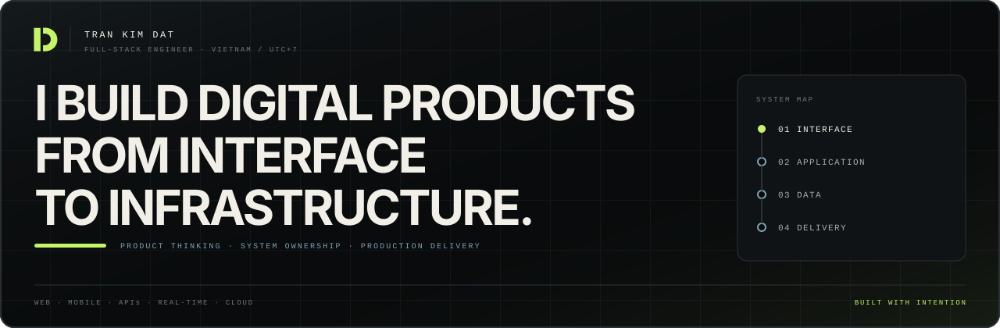
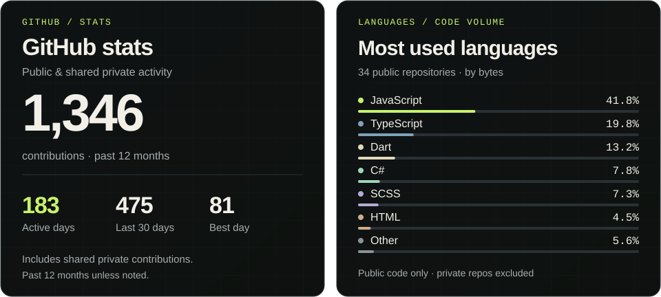
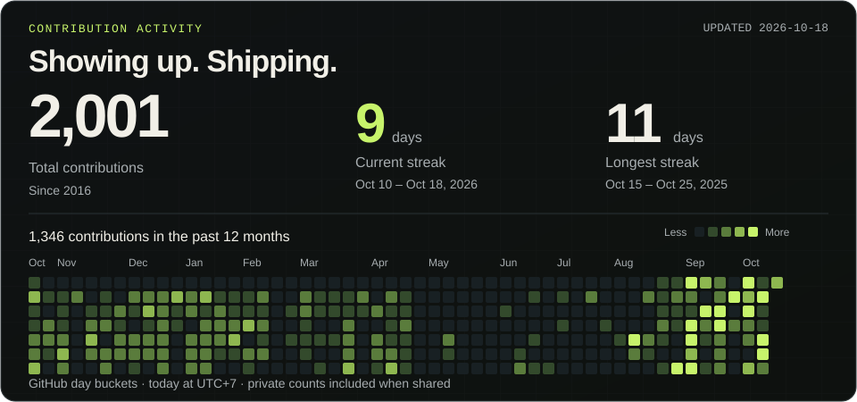

  <picture>
    <source media="(max-width: 479px), (min-width: 768px) and (max-width: 879px)" srcset="./assets/profile-masthead-mobile.svg" />
    <source media="(max-width: 1100px)" srcset="./assets/profile-masthead-wide.svg" />
    
  </picture>

  <a href="https://www.dattk.dev"><strong>Portfolio</strong></a>
  &nbsp;·&nbsp;
  <a href="https://www.dattk.dev/api/cv"><strong>CV</strong></a>
  &nbsp;·&nbsp;
  <a href="https://www.linkedin.com/in/kimdat0705"><strong>LinkedIn</strong></a>
  &nbsp;·&nbsp;
  <a href="mailto:kimdat0705@gmail.com"><strong>Email</strong></a>

I am a product-focused full-stack engineer in Vietnam with 3+ years of experience across production web and cross-platform mobile products. I work where the layers meet: turning a product requirement into an interface, the systems behind it, and a release that can be operated with confidence.

My range spans TypeScript, Python, C#, Dart, and SQL; React, Next.js, Flutter, FastAPI, NestJS, and ASP.NET Core; PostgreSQL, MongoDB, Redis, real-time systems, automated testing, containers, CI, and cloud delivery.

## GitHub activity

  <a href="https://github.com/dattk2002?tab=overview">
    <picture>
      <source media="(max-width: 479px), (min-width: 768px) and (max-width: 879px)" srcset="./assets/github-stats-mobile.svg" />
      <source media="(max-width: 1100px)" srcset="./assets/github-stats-wide.svg" />
      <source media="(max-width: 1439px)" srcset="./assets/github-stats-tablet.svg" />
      
    </picture>
  </a>

  <a href="https://github.com/dattk2002?tab=overview">
    <picture>
      <source media="(max-width: 479px), (min-width: 768px) and (max-width: 879px)" srcset="./assets/github-activity-mobile.svg" />
      <source media="(max-width: 1100px)" srcset="./assets/github-activity-wide.svg" />
      <source media="(max-width: 1439px)" srcset="./assets/github-activity-tablet.svg" />
      
    </picture>
  </a>

<!-- PROFILE-STATS:START -->

Activity in numbers · updated 2026-10-17

| Metric | Value | Scope |
| --- | ---: | --- |
| All-time contributions | 1,961 | Since 2016-07-25 |
| Contributions | 1,309 | 2025-10-18 to 2026-10-17 |
| Current streak | 8 days | Oct 10 – Oct 17, 2026 |
| Longest streak | 11 days | Oct 15 – Oct 25, 2025 |
| Active days | 184 | Days with at least one contribution in the past 12 months |
| Contributions in the last 30 days | 432 | 2026-09-18 to 2026-10-17 |
| Most contributions in a day | 81 | 2026-10-12; past 12 months |

**Languages by public code volume:** JavaScript 41.8% · TypeScript 19.8% · Dart 13.2% · C# 7.8% · SCSS 7.3% · HTML 4.5% · Other 5.6%.

Language shares measure code bytes across 34 original public repositories, including archives. Forks and this generated profile repository are excluded. These are code proportions, not proficiency scores.

These statistics use GitHub's contribution calendar, including private counts when shared. The owner primarily works in private repositories; 1,197 contributions in this period have restricted details. Private repository names and content remain private.

Streaks use GitHub's daily calendar buckets and UTC+7 to determine today. A day still in progress does not break yesterday's streak. [Data sources and update method](./docs/profile-cards.md).

<!-- PROFILE-STATS:END -->

## Building now

### [Bravodemy](https://bravodemy.com) — learning systems grounded in sources

An AI microlearning platform that turns a natural-language goal into a researched syllabus, focused 5–10 minute lessons, practice, spaced review, and visible progress.

`goal` → `grounded research` → `learning path` → `practice` → `review`

I own most of the architecture and end-to-end delivery: a bilingual Next.js interface, 107 FastAPI endpoints, 35 SQLAlchemy models, Gemini Grounded Search, Exa, and Tavily research workflows, deterministic Python and SQL grading, Langfuse tracing, automated test suites, and production delivery on Render and Neon.

[View the product](https://bravodemy.com)

## Selected systems

### [TapMood](https://github.com/dattk2002/tap-mood-ui)

A real-time social check-in product built across Flutter and ASP.NET Core. The system includes SignalR, Firebase notifications, Gemini-assisted features, and resumable media uploads with background video processing.

[Interface source](https://github.com/dattk2002/tap-mood-ui) · [API source](https://github.com/dattk2002/tap-mood-api)

### [HabiStride](https://habi-stride-ui.onrender.com)

A gamified habit tracker built with Next.js and NestJS, including Google OAuth, HttpOnly authentication, streak logic, leaderboards, and daily timezone-aware snapshots.

[Live product](https://habi-stride-ui.onrender.com) · [Interface source](https://github.com/dattk2002/habi-stride-ui) · [API source](https://github.com/dattk2002/habi-stride-api)

### [dattk.dev](https://www.dattk.dev)

My portfolio is also a working product: ten evidence-led case studies, live GitHub activity, an accessible gesture-based project explorer, a two-way contact workflow, and a localized publishing system backed by Neon Postgres.

[Visit the portfolio](https://www.dattk.dev) · [Explore the source](https://github.com/dattk2002/dattk2002-portfolio-nextjs)

## How I ship

  <picture>
    <source media="(max-width: 479px), (min-width: 768px) and (max-width: 879px)" srcset="./assets/how-i-ship-mobile.svg" />
    <source media="(max-width: 1100px)" srcset="./assets/how-i-ship-wide.svg" />
    <source media="(max-width: 1439px)" srcset="./assets/how-i-ship-tablet.svg" />
    
  </picture>

**Gemini Grounded Search:** grounding with Google Search through the Gemini API, using an API key created in [Google AI Studio](https://aistudio.google.com/apikey).

I care about clear ownership, maintainable architecture, and evidence that a feature works outside the happy path.

## Beyond the code

- Software Engineering graduate from FPT University.
- EF SET English Certificate: C2 Proficient, 78/100.
- Based in Vietnam; available in Da Nang, Ho Chi Minh City, and remotely.
- Open to international full-stack engineering opportunities and product collaborations.

## Start a conversation

For work, collaboration, or a thoughtful exchange about building products:

**[kimdat0705@gmail.com](mailto:kimdat0705@gmail.com)** · **[LinkedIn](https://www.linkedin.com/in/kimdat0705)** · **[dattk.dev](https://www.dattk.dev)**
